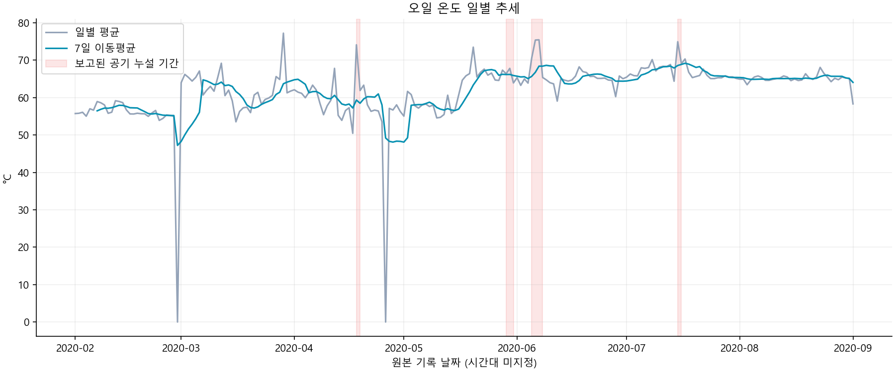
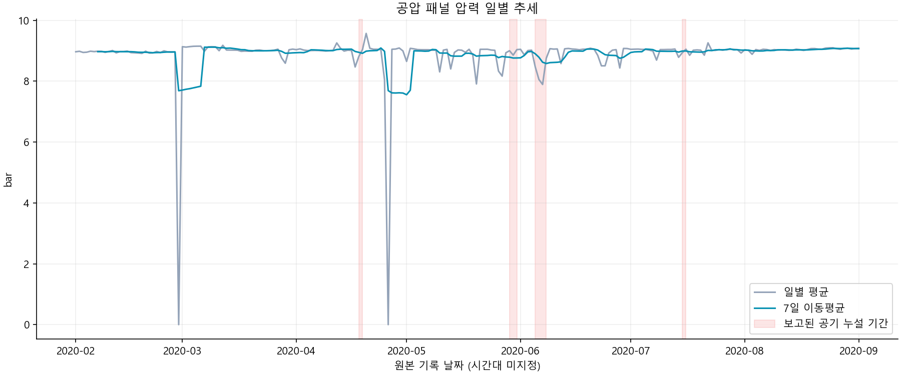
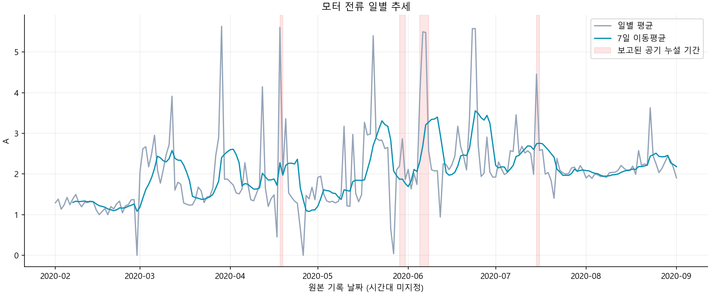

# HYDRA — 설비 센서 분석 및 이상 수치 관리 리포트

## 1. 주제와 선정 이유
실제 날짜가 포함된 MetroPT-3 압축기 센서 기록으로 장기간 운전 패턴과 공기 누설 보고 구간을 비교한다. 사출기·판금기의 실측 데이터가 아니라 열차 공기 생산 장치(APU)의 압축기 데이터다. 이전 60초 실험 데이터는 본 분석에 사용하지 않는다.

## 2. 분석 질문
1. 일별 평균 오일 온도와 7일 이동평균은 어떻게 변하는가?
2. 공기 누설이 보고된 날짜의 온도·압력·전류는 다른 날짜와 어떻게 다른가?
3. 하루 내부의 최솟값·최댓값과 시간대 패턴은 어떤 정보를 주는가?
4. 데이터 공백과 하루별 관측량 차이가 해석에 어떤 한계를 주는가?

## 3. 출처·기간·컬럼
- 출처: [UCI MetroPT-3](https://archive.ics.uci.edu/dataset/791/metropt+3+dataset), DOI 10.24432/C5VW3R.
- 제작자: Davari, N., Veloso, B., Ribeiro, R., & Gama, J. (2021). 라이선스 CC BY 4.0. 원본 센서 기록을 일별·시간별로 가공했다.
- 실제 범위: **2020-02-01 00:00:00 ~ 2020-09-01 03:59:50**, 원본 1,516,948행.
- 전체 달력 214일 중 관측일 **212일**, 완전 공백 2일. 원본 시간대가 명시되지 않아 한국 시간으로 변환하지 않았다.
- TP2 압축기 압력(bar), TP3 공압 패널 압력(bar), Oil_temperature 오일 온도(°C), Motor_current 모터 전류(A), timestamp 측정 시각.
- 공식 설명에는 원장치 1Hz 로깅과 공개본 0.1Hz가 모두 언급된다. 실제 인접 관측 중앙 간격은 10초, 최대 공백은 172,918초다.

## 4. 정제·시계열 분석
- 날짜 파싱, 정렬, 중복 및 센서 결측·무한값을 검사했다. 선택 센서 결측·무한값 0개, 중복 시각 0개다.
- 사용자 지정 기준으로 관측이 전혀 없는 날짜·시간은 미가동으로 가정하고 센서 평균·최솟값·최댓값·표준편차를 0으로 채운다. assumed_off 열로 가정 여부를 보존한다. 원본 기록은 변경하지 않는다. 실제 정지나 실제 온도 0°C를 확인한 것은 아니다. 부분 관측 시간 내부의 짧은 공백은 추가로 0을 삽입하지 않는다.
- 극값은 기동·정지나 실제 이상을 담을 수 있어 삭제하지 않는다. 모든 값은 측정값이지 고장 판정이 아니다.
- 일별 평균·최솟값·최댓값·표준편차·관측 수를 산출한다. 하루 단위로 장기 흐름을 보되 순간 변화는 시간별 상세와 범위로 보완한다. 불규칙 공백을 고려한 시간가중 평균은 아니다.
- 7개 달력일 이동평균은 미가동 가정으로 채운 0도 포함한다. 최초 6일은 계산하지 않는다. 0 대체는 평균을 낮추므로 원본 관측 기반 통계와 구분한다.
- 추세는 장기 수준 변화, 계절성은 반복 시간 패턴, 노이즈는 불규칙 변동이다. 수개월 자료로 연간 계절성을 주장하지 않는다. 운영 조건·외기온도 영향을 줄 수 있다.
- 원 출처 공기 누설 보고 4개 구간과 겹친 날짜를 표시한다. 보고 없는 날짜를 검증된 정상으로 간주하지 않는다.

## 5. 시각화와 인사이트
### 5.1 오일 온도

- 관찰: 일평균 최고는 2020-03-29의 77.24°C, 최저는 2020-04-17의 50.45°C다.
- 해석(가설): 장기 수준 차이는 부하·주변 온도·정비·이상 상태가 복합적으로 작용한 결과일 수 있다. 높은 온도만으로 고장을 단정할 수 없다.
- 활용: 일별 평균과 7일 평균을 함께 보며 변화가 지속되는 구간을 상세 조회한다.

### 5.2 공압 패널 압력

- 관찰: 보고 구간과 겹친 7일의 일평균 TP3 평균은 8.575bar, 나머지 205일은 8.982bar다. 날짜마다 같은 가중치를 부여했다.
- 해석(가설): 압력은 누설과 관련될 수 있지만 제어로 유지되거나 운전 조건에 좌우될 수도 있다. 보고일이 적고 하루 중 일부만 고장 구간이므로 단순 평균 비교의 한계가 크다.
- 활용: 보고일과 이전·이후 날짜의 시간별 최솟값·최댓값을 비교한다. 보고 표시는 예측 결과가 아니다.

### 5.3 모터 전류

- 관찰: 일평균 최고는 2020-03-29의 5.632A, 관측일 일평균 전류의 중앙값은 2.000A다.
- 해석(가설): 평균 전류 증가는 부하 운전 비중 또는 운전 스케줄 변화일 수 있다. 누설 원인으로 확정하려면 공기 수요·운전 모드를 함께 봐야 한다.
- 활용: 전류와 압력·온도를 함께 확인하고 해당 날짜의 시간별 기록을 점검한다.

## 6. 결론 및 한계
일별 전체 추세로 장기 변화를 확인하고 선택 날짜의 시간별 상세로 이동하는 구조다. 100일 이상 실제 날짜 기록을 확보했다. 일/시간 요약은 빠른 변화를 숨길 수 있어 최솟값·최댓값도 표시한다.
하나의 열차 압축기 기록이며 실제 공장 설비와 다르다. 운전 부하·외기온을 통제하지 않았다. 공백을 미가동으로 가정한 0은 관측 사실이 아니며 온도·압력의 실제 0을 뜻하지 않는다. 부분 관측일 평균은 원본 관측값 기준이다. 인사이트 수치는 관측이 있는 날짜만 사용한다. 미래 예측·인과효과는 검증하지 않았다. 사용자 설정에 따른 이상 후보 관리 기능은 있으나 실제 고장 감지 성능은 검증하지 않았다. 빨간 구간은 원 출처 보고를 재표시한 것이다.

## 7. AI 사용 로그
|작업|사용 이유|검증 방법|
|---|---|---|
|날짜 포함 설비 데이터 탐색|일별 분석 요건 충족|UCI 설명·라이선스·실제 timestamp 대조|
|집계·그래프·코드 작성|재현 가능한 분석|행 수·결측·중복·간격 검사, 원본 하루 재집계 검증|
|리포트 해석|관찰과 가설 구분|코드 계산 수치 사용, 보고일과 정상 라벨 구분|
|대시보드 작성|기간·날짜별 탐색|센서·기간·날짜 변경 동작 확인|

AI 초안이므로 제출자는 본인이 검토한 판단과 수정 사항을 추가해야 한다.

<!-- PROJECT_GUIDE_START -->

## 8. 실행 방법

Python **3.10 이상**이 필요합니다. 개발·실행 검증은 Windows와 Python 3.13에서 진행했습니다. 웹 화면은 별도 프레임워크 설치 없이 제공됩니다.

### 최초 실행 — Windows PowerShell

프로젝트 폴더에서 실행합니다.

```powershell
py -m venv .venv
.\.venv\Scripts\python.exe -m pip install -r requirements.txt
.\.venv\Scripts\python.exe analysis.py
.\.venv\Scripts\python.exe verify.py
.\.venv\Scripts\python.exe -m http.server 8000 --bind 127.0.0.1
```

브라우저에서 **[http://127.0.0.1:8000/dashboard/](http://127.0.0.1:8000/dashboard/)** 를 엽니다. 서버 터미널은 실행 중 켜두고, 종료하려면 `Ctrl+C`를 누릅니다.

### 결과물이 이미 있을 때

```powershell
.\.venv\Scripts\python.exe -m http.server 8000 --bind 127.0.0.1
```

집계 데이터가 포함되어 있으면 분석을 다시 실행하지 않고 대시보드를 볼 수 있습니다. 수정한 화면이 반영되지 않으면 `Ctrl+F5`로 새로고침합니다. 8000 포트를 이미 사용 중이면 기존 서버를 사용하거나 명령의 포트를 변경하고 같은 포트로 접속합니다.

### macOS / Linux

```bash
python3 -m venv .venv
.venv/bin/python -m pip install -r requirements.txt
.venv/bin/python analysis.py
.venv/bin/python verify.py
.venv/bin/python -m http.server 8000 --bind 127.0.0.1
```

그래프 기본 글꼴은 Windows의 맑은 고딕입니다. 다른 운영체제에서 한글이 깨지면 `analysis.py`의 `font.family`를 설치된 한글 글꼴로 변경합니다.

의존성은 `requirements.txt`에 버전을 고정했습니다.

- NumPy 2.2.6
- pandas 2.2.3
- Matplotlib 3.10.3

## 9. 사용 방법

### 과거 데이터 조회

1. 센서와 조회 기간을 선택하고 **기간 적용**을 누릅니다.
2. 일별 평균과 7일 이동평균으로 장기 변화를 확인합니다.
3. 그래프를 클릭하거나 날짜를 선택해 해당 날짜의 센서 4종을 비교합니다.
4. **전날 / 다음 날**로 이동하며 운전 패턴을 살펴봅니다.

빨간 배경은 원 출처에서 공기 누설·높은 부하가 보고된 기간입니다. 이 표시가 그래프의 모든 급등 원인을 설명하는 것은 아닙니다. **과거 처리 이력**에서 사건 설명을 확인하고 담당자·상태·점검 내용을 수정해 저장할 수 있습니다.

### 새 측정값 입력

1. **새 측정값 입력**에서 측정 시각을 지정합니다.
2. 압축기 압력·공압 패널 압력·오일 온도·모터 전류를 입력합니다.
3. **측정값 등록**을 누르면 한 번에 저장하고 센서별 기준으로 판정합니다.
4. 같이 등록한 값은 최근 입력 표의 한 행에 표시됩니다. 입력 날짜의 그래프에도 반영됩니다.

공란은 미입력으로 남기고, **직접 입력한 0은 유효한 측정값**으로 판정합니다. 최소 한 항목은 입력해야 합니다. 기준을 벗어난 항목마다 미확인 점검 건이 생성됩니다.

### 이상 수치 확인과 조치

1. **감지 기준 설정**에서 센서별 하한·상한과 사용 여부를 저장합니다.
2. 신규 입력값이 하한 미만 또는 상한 초과이면 이상 후보로 분류합니다. 경계값과 같으면 범위 안입니다.
3. 이상 목록의 **확인·조치**에서 상태·담당자·메모를 기록합니다.
4. **조치 완료**로 저장하려면 점검·조치 내용이 필요합니다.
5. **발생일 그래프 보기**로 해당 날짜의 기록을 확인합니다.

기준 변경은 다음 입력부터 적용합니다. 기존 입력의 당시 판정과 조치 이력은 소급 변경하지 않습니다. 신규 값은 단일 입력 즉시 판정하며 연속 시간 조건을 적용하지 않습니다.

초기 하한·상한은 과거 첫 달 시간평균의 1~99백분위에서 만든 예시입니다. 제조사 기준이 아니고 단일 측정값용으로 검증한 기준도 아니므로, 실제 활용에는 운전 조건에 맞는 설정과 검증이 필요합니다.

### 저장·내보내기·삭제

- 입력값·설정·조치 이력은 **현재 브라우저의 localStorage**에 저장됩니다.
- 다른 브라우저·기기와 공유되지 않으며, 브라우저 저장 데이터를 지우면 사라질 수 있습니다.
- **관리 기록 내보내기**로 입력값·설정·조치 이력을 JSON 파일로 보관합니다. 가져오기 기능은 없습니다.
- **삭제할 날짜 → 해당 날짜 입력 삭제**로 직접 입력값과 연결 조치 기록을 삭제합니다. 원본 공개 데이터는 삭제하지 않습니다.
- 여러 탭에서 동시에 수정하면 마지막 저장이 반영될 수 있으므로 한 탭에서 작업하는 것을 권장합니다.

## 10. 과제 요구사항 대응

| 요구사항 | 결과물 |
|---|---|
| 100개 이상 시계열 포인트 | 실제 관측 212일, 원본 1,516,948행 |
| 출처·기간·컬럼 설명 | 본 문서 |
| 질문 3개 이상 | 2절의 분석 질문 4개 |
| 정제 및 분석 기법 2개 이상 | 결측·중복 검사, 이동평균·표준편차·일별 통계 |
| 시각화 2개 이상 | 5절에 PNG 3개 포함 |
| 인사이트 3개 이상 | 5절의 관찰·해석·활용 3개 |
| Python 코드와 재현 방법 | analysis.py / requirements.txt / 본 문서 |
| AI 사용 투명성 | 7절의 작업·이유·검증 방법 |
| GitHub 저장소 | 본 프로젝트를 본인 원격 저장소에 게시하고 제출 URL 제공 필요 |
| 대시보드 보너스 | 기간·날짜·센서 탐색, 신규 입력 및 조치 관리 구현 |
| 분해·예측 보너스 | 수행하지 않음 |

## 11. 대시보드 시연·보너스 제출

과제의 **스크린샷 세트 + 필터/기간 변경 시나리오** 방식으로 제출할 수 있습니다. 최종 사용 화면에서 다음 순서로 캡처하면 됩니다.

| 순서 | 시나리오 | 확인할 내용 |
|---|---|---|
| 1 | 전체 기간 오일 온도 조회 | 일별 추세와 7일 이동평균 |
| 2 | 2020-04-01~04-30 조회, 04-18 선택 | 누설 보고 구간과 시간별 센서 4종 |
| 3 | 새 시각에 센서 4개 일괄 입력 | 같은 입력 건 한 행, 신규 날짜 그래프 |
| 4 | 입력 기준을 벗어난 항목 확인 | 미확인 건과 입력 당시 판정 |
| 5 | 담당자·내용 작성 후 조치 완료 | 상태 변경, 새로고침 후 유지 |

입력값은 테스트 데이터임을 조치 메모에 남깁니다. 테스트를 마친 뒤 날짜별 삭제로 정리할 수 있습니다. 단순 `localhost` 주소는 다른 사람에게 접속 가능한 배포 URL이 아니므로, URL 제출 방식으로 사용하지 않습니다.

`images/`에 개발 과정의 화면 캡처도 포함되어 있지만 일부는 이전 화면입니다. 최종 보너스 제출에는 최신 실행 화면에서 캡처한 세트를 사용하세요.

## 12. 파일 구조

```text
machine-monitor/
├─ dashboard/
│  ├─ index.html          # 화면, 일괄 입력, 조치 관리, 브라우저 저장
│  ├─ alerts.js           # 초기 통계 기준 및 감지 보조 로직
│  └─ data.json           # 원본에서 가공한 화면용 기록
├─ data/
│  ├─ raw/                # 다운로드 원본 ZIP, Git 제외
│  ├─ daily_summary.csv   # 일별 센서 통계
│  ├─ hourly_summary.csv  # 시간별 센서 통계
│  └─ validation.json     # 기간·관측 수·공백·원본 해시
├─ images/                # 리포트 그래프 및 개발 화면 캡처
├─ analysis.py            # 수집·집계·그림·리포트 재생성
├─ verify.py              # 원본과 집계 결과 대조
├─ test-alerts.cjs        # 감지 보조 로직 검사 (Node.js)
├─ requirements.txt
└─ legacy-uci447/         # 교체 전 데이터용 코드·문서 백업
```

`legacy-uci447/`은 현재 실행·분석 대상이 아닙니다. 현재 기준은 MetroPT-3 데이터입니다. 원본 재다운로드가 필요하면 `data/raw/metropt3.zip`을 제거한 뒤 `analysis.py`를 재실행합니다. 재생성은 CSV·PNG·화면용 JSON·REPORT를 덮어쓰지만 브라우저의 직접 입력값은 변경하지 않습니다.

## 13. 검증 및 한계

```powershell
.\.venv\Scripts\python.exe verify.py
```

원본 일부 날짜를 직접 집계해 CSV·화면용 JSON과 대조하고, 이동평균·미관측 0 처리·리포트 이미지 경로를 검사합니다.

Node.js가 있으면 감지 보조 로직도 확인할 수 있습니다.

```powershell
node test-alerts.cjs
```

이 검사는 연속시간 기반 보조 함수의 경계·미가동 제외 등을 다룹니다. 현재 신규 입력 화면은 단일값 즉시 판정이므로, 이 명령만으로 입력·저장·조치 화면 전체를 검증한 것은 아닙니다. 화면에서는 4개 일괄 입력 → 그래프 반영 → 이상 건 조치 → 새로고침 후 유지 흐름을 별도로 확인해야 합니다.

현재 기능은 과제용 로컬 시제품입니다. 검증된 고장 진단·미래 예측, 실제 기계 통신·제어, 다중 사용자 공유 서버는 포함하지 않습니다. 브라우저에 들어 있는 검증용 입력은 실제 원본 데이터와 구분하며 분석 리포트 계산에는 사용하지 않습니다.

